<picture>
  <source media="(prefers-color-scheme: dark)" srcset="./assets/hero-dark.svg">
  
</picture>

**[GitHub](https://github.com/akshaysharma2005)** &nbsp;·&nbsp; **[LinkedIn](https://www.linkedin.com/in/m-akshay-sharma)** &nbsp;·&nbsp; **[Email](mailto:akshaysharma200508@gmail.com)** &nbsp;·&nbsp; **[Resume](mailto:akshaysharma200508@gmail.com)**

 

Computer Science undergraduate specializing in **Data Analytics** at **VIT-AP University**, Amaravati (CGPA: 8.32/10). I combine data-driven problem solving with modern full-stack development: designing optimized **SQL queries & analytical dashboards**, processing large datasets in **Python (Pandas, Matplotlib, Seaborn)**, and engineering responsive web apps using the **MERN stack** and **AWS cloud infrastructure**.

Passionate **football tactician and sports analytics enthusiast** — dissecting matchday spatial event logs, pass probability networks, and Expected Goals (xG) models at the intersection of athletics and computation. Actively seeking **Software Development** or **Data Science / Analytics** internship and engineering opportunities.

### Selected work

<a href="https://github.com/akshaysharma2005/SoundPulse"><picture><source media="(prefers-color-scheme: dark)" srcset="./assets/soundpulse-dark.svg"></picture></a>&nbsp;<a href="https://github.com/akshaysharma2005/football-analytics"><picture><source media="(prefers-color-scheme: dark)" srcset="./assets/football-dark.svg"></picture></a>
<a href="https://github.com/akshaysharma2005/Healthcare-Analytics"><picture><source media="(prefers-color-scheme: dark)" srcset="./assets/healthcare-dark.svg"></picture></a>&nbsp;<a href="https://github.com/akshaysharma2005"><picture><source media="(prefers-color-scheme: dark)" srcset="./assets/cloud-dark.svg"></picture></a>

### The Beautiful Game · Football Analytics

<picture>
  <source media="(prefers-color-scheme: dark)" srcset="./assets/football-matrix-dark.svg">
  
</picture>

 

### Toolkit

<picture>
  <source media="(prefers-color-scheme: dark)" srcset="./assets/toolkit-dark.svg">
  
</picture>

 

**Certifications:** AWS Academy Graduate — Cloud Architecting · AWS Academy Graduate — Cloud Foundations · MERN Full Stack Development (FacePrep, 2025)
