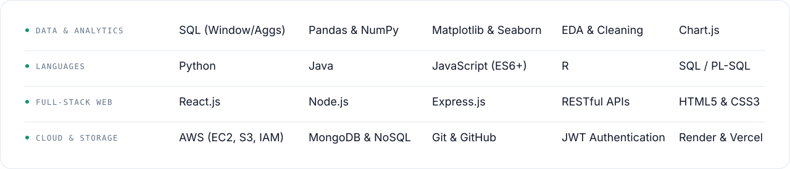

<picture>
  <source media="(prefers-color-scheme: dark)" srcset="./assets/hero-dark-v2.svg">
  
</picture>

**[GitHub](https://github.com/akshaysharma2005)** &nbsp;·&nbsp; **[LinkedIn](https://www.linkedin.com/in/m-akshay-sharma-a7414b367/)** &nbsp;·&nbsp; **[Email](mailto:akshaysharma200508@gmail.com)** &nbsp;·&nbsp; **[Resume](https://drive.google.com/file/d/1kAvZECBbI3gPE6oZu3TbyU5W4GwPmVf-/view?usp=sharing)**

 

Computer Science undergraduate specializing in **Data Analytics** at **VIT-AP University**, Amaravati (CGPA: 8.32/10). I combine data-driven problem solving with modern full-stack development: designing optimized **SQL queries & analytical dashboards**, processing large datasets in **Python (Pandas, Matplotlib, Seaborn)**, and engineering responsive web apps using the **MERN stack** and **AWS cloud infrastructure**.

Passionate **football tactician and sports analytics enthusiast** — dissecting matchday spatial event logs, pass probability networks, and Expected Goals (xG) models at the intersection of athletics and computation. Actively seeking **Software Development** or **Data Science / Analytics** internship and engineering opportunities.

### Selected work

<a href="https://soundpulse-1.onrender.com/"><picture><source media="(prefers-color-scheme: dark)" srcset="./assets/soundpulse-dark-v2.svg"></picture></a>&nbsp;<a href="https://github.com/akshaysharma2005/football-analytics"><picture><source media="(prefers-color-scheme: dark)" srcset="./assets/football-dark-v2.svg"></picture></a>
<a href="https://drive.google.com/file/d/1-LLqf_7I9KnQ3wuPdkXstDBYjI5Mj0wT/view"><picture><source media="(prefers-color-scheme: dark)" srcset="./assets/healthcare-dark-v2.svg"></picture></a>&nbsp;<a href="https://www.credly.com/badges/b9e4c77d-96ca-4aa7-a0d2-e8e91158c7ed/public_url"><picture><source media="(prefers-color-scheme: dark)" srcset="./assets/cloud-dark-v2.svg"></picture></a>

### The Beautiful Game · Football Analytics

<picture>
  <source media="(prefers-color-scheme: dark)" srcset="./assets/football-matrix-dark-v2.svg">
  
</picture>

 

### Toolkit

<picture>
  <source media="(prefers-color-scheme: dark)" srcset="./assets/toolkit-dark-v2.svg">
  
</picture>

 

**Certifications:** [AWS Academy Graduate — Cloud Architecting](https://www.credly.com/badges/b9e4c77d-96ca-4aa7-a0d2-e8e91158c7ed/public_url) · [AWS Academy Graduate — Cloud Foundations](https://www.credly.com/badges/b9e4c77d-96ca-4aa7-a0d2-e8e91158c7ed/public_url) · MERN Full Stack Development (FacePrep, 2025)
